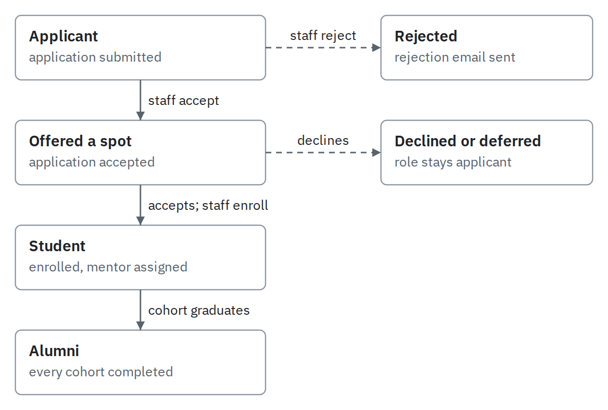

<picture>
  <source media="(prefers-color-scheme: dark)" srcset="tools/banner/banner-dark.png">
  
</picture>

[](https://staija.org)
[](https://vuejs.org)
[](https://www.typescriptlang.org)
[](https://firebase.google.com)
[](https://tailwindcss.com)
[](https://vitejs.dev)
[](#license)

# STAIJA

> **Educational platform supporting Nigeria's future STEM leaders.** Manages student scholarship applications, mentorship pairings, course learning, and alumni networks.

## 💡 What is STAIJA?

The Science and Technology Association for Indigenous Jumpstart Advancement (STAIJA) empowers students across Nigeria to pursue careers in science, technology, engineering, and mathematics. 

This platform serves as the central digital hub for STAIJA's scholarship programs (StepUp Scholars and Dynamerge). It streamlines the entire student journey: applying online, matching admitted students with professional mentors, delivering coursework and assignments, and maintaining an active alumni network.

**Live site:** [staija.org](https://staija.org)

## How it works

A person moves from applicant to student to alumni, and staff make each move:

<picture>
  <source media="(prefers-color-scheme: dark)" srcset="assets/diagrams/lifecycle-dark.png">
  
</picture>

An applicant signs up and submits a StepUp Scholars or Dynamerge form, and Mailgun confirms receipt. Staff accept or reject the application. An accepted applicant can take the spot, decline it, or defer to the next cycle. Once they accept, staff enroll them in a cohort with a mentor and their role becomes student. Students and mentors use the LMS for lessons, assignments, sessions, notes, and feedback. When every cohort a student is in has graduated, their role becomes alumni. [Edit the diagram](assets/diagrams/lifecycle.html).

Side flows (donations via Paystack, newsletter via Mailgun, CMS content from Contentful → Firestore via webhook) feed the same Firestore + Functions backbone.

## Demos

Recordings of the [E2E demo suite](./e2e) — generated by `npm run demo`, single-worker headless Playwright with `slowMo: 1200` so each beat is readable at 1×.

<details>
<summary><b>Public site tour</b> — homepage → programs → about → get involved → contact</summary>

<video src="e2e/videos/public-site-tour-visitor-explores-the-staija-homepage-and-programs.mp4" controls></video>

</details>

## Stack

| Layer | Technology |
| --- | --- |
| Frontend | Vue 3 + Vite + TypeScript |
| Auth | Firebase Authentication (email/password, Google) |
| Database | Cloud Firestore |
| File storage | Firebase Storage |
| Backend logic | Firebase Cloud Functions (Node 22) |
| CMS | Contentful → mirrored to Firestore via webhook |
| Email | Mailgun (transactional + newsletters) |
| Payments | Paystack (donations) |
| Hosting | Vercel (frontend SPA) |

## Prerequisites

- Node 22+
- Firebase CLI: `npm install -g firebase-tools`then`firebase login`
- A Firebase project on the **Blaze** plan (required for Cloud Functions; see the infrastructure notes)

## Local development

```bash

# 1. Install frontend dependencies

npm install

# 2. Copy the env template and fill in your Firebase + Contentful keys

cp .env.example .env

# 3. Start the dev server (http://localhost:5190)

npm run dev
```

## Environment variables

All frontend config is injected at build time via `VITE_*`variables in`.env`:

```dotenv
VITE_FIREBASE_API_KEY
VITE_FIREBASE_AUTH_DOMAIN
VITE_FIREBASE_PROJECT_ID
VITE_FIREBASE_STORAGE_BUCKET
VITE_FIREBASE_PUBLIC_BUCKET
VITE_FIREBASE_MESSAGING_SENDER_ID
VITE_FIREBASE_APP_ID
VITE_FIREBASE_MEASUREMENT_ID

VITE_CONTENTFUL_SPACE_ID
VITE_CONTENTFUL_DELIVERY_TOKEN
VITE_CONTENTFUL_PREVIEW_TOKEN
CONTENTFUL_MANAGEMENT_TOKEN
VITE_CONTENTFUL_ENV_ID

VITE_PAYSTACK_PUBLIC_KEY
VITE_NEWSLETTER_ENDPOINT            # subscribeNewsletter URL; blank until deployed
VITE_PUBLIC_MENTORS_ENDPOINT        # getPublicMentors Cloud Function URL (public mentor showcase)
VITE_REFERRER_NAME_ENDPOINT         # resolveReferrerName Cloud Function URL (personalised /stay-connected hero)
VITE_APP_URL

VITE_RECAPTCHA_ENTERPRISE_SITE_KEY  # Firebase App Check site key (public)
```

The three `*_ENDPOINT` vars are optional. Each surface degrades to a sensible
empty state when its endpoint is unset:

- `VITE_NEWSLETTER_ENDPOINT` unset → newsletter forms show an unavailable state

  and do not submit or record a newsletter signup.

Keep `VITE_NEWSLETTER_ENDPOINT` unset until the Mailgun list exists,
`MAILGUN_LIST_ADDRESS` is set in Firebase Secret Manager, and the exported
`subscribeNewsletter` function is deployed. Use the URL for the matching
Firebase project. Do not point production or staging at a guessed or
undeployed function URL.

- `VITE_PUBLIC_MENTORS_ENDPOINT`unset →`/stay-connected`'s mentor showcase

  renders its "Mentor profiles coming soon" empty state.

- `VITE_REFERRER_NAME_ENDPOINT`unset →`/stay-connected` falls back to the

  generic hero copy even when `?ref=u-<uid>` is in the URL.

`.env`is gitignored. It is only read by the Vite build — Cloud Functions read secrets from Firebase Secret Manager, not from`.env`.

## Cloud Functions

Functions live in [`functions/`](./functions) with their own `package.json`.

```bash
cd functions && npm install
```

Secrets are stored in Firebase Secret Manager (not `.env`). Before first deploy:

```bash
echo -n "<value>" | firebase functions:secrets:set MAILGUN_API_KEY          --data-file -
echo -n "<value>" | firebase functions:secrets:set MAILGUN_DOMAIN           --data-file -
echo -n "<value>" | firebase functions:secrets:set MAILGUN_LIST_ADDRESS     --data-file -
echo -n "<value>" | firebase functions:secrets:set PAYSTACK_SECRET_KEY      --data-file -
echo -n "<value>" | firebase functions:secrets:set CONTENTFUL_WEBHOOK_SECRET --data-file -
echo -n "<value>" | firebase functions:secrets:set REFERENCE_TOKEN_SECRET   --data-file -
```

See the infrastructure notes for the full secret inventory, the Mailgun sandbox-vs-verified-domain setup, and cost notes.

## Tests

```bash
npm test             # vitest run (all tests, single pass)
npm run test:watch   # vitest in watch mode
```

Tests live in [`tests/`](./tests). Service-layer tests mock Firebase; component tests use `@vue/test-utils`with`happy-dom`.

## Build & deploy

```bash

# Build

npm run build

# Deploy frontend (Vercel picks this up automatically on push to main

# or run manually)

vercel --prod

# Deploy Cloud Functions

firebase deploy --only functions

# Deploy Firestore rules + indexes and Storage rules

firebase deploy --only firestore,storage
```

## User roles

| Role | Who |
| --- | --- |
| `applicant` | Anyone who creates an account |
| `student` | Accepted and active program participants |
| `alumni` | Past participants |
| `mentor` | Assigned mentors |
| `staff` | STAIJA team (@staija.org email, verified) |
| `admin` | Full access |

## License

MIT — see [LICENSE](./LICENSE).
